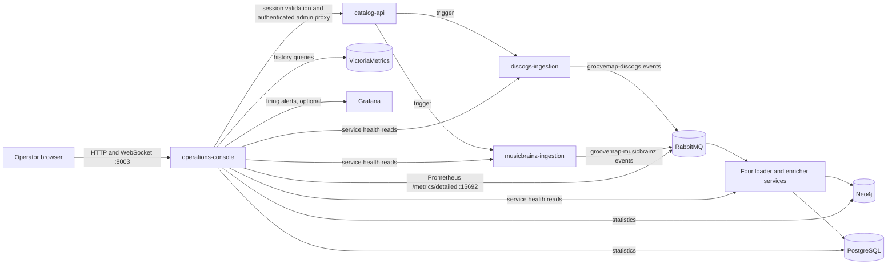
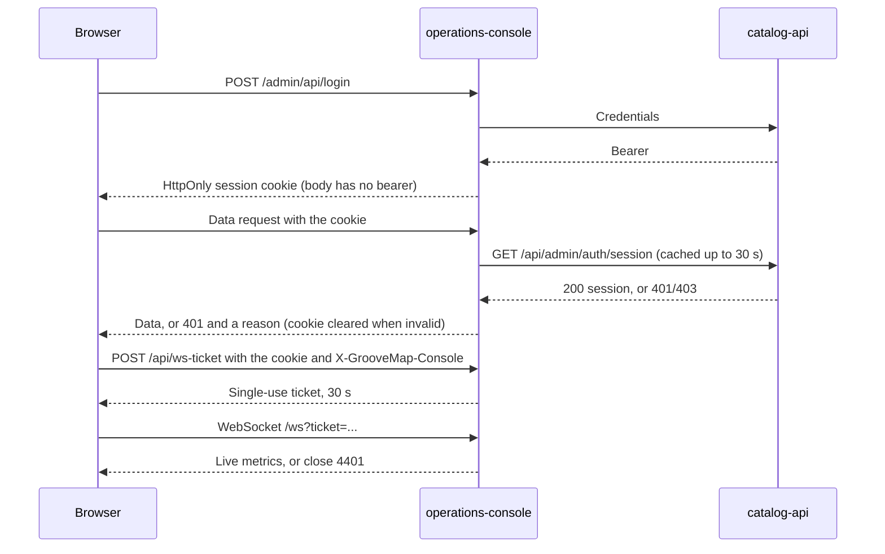
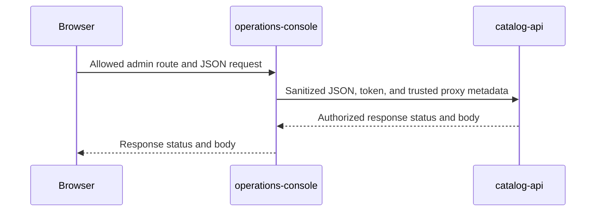

# Operations-console architecture

The operations console is the human-facing observability and privileged-administration surface for GrooveMap. It reads service, queue, Neo4j, and PostgreSQL health, presents live and historical metrics, and proxies authenticated operator requests to `catalog-api`. It does not own authentication, extraction, message consumption, or datastore schema.

## Repository boundary

`catalog-api` owns login, authorization, audit persistence, and privileged endpoints.
`discogs-ingestion` owns the Discogs producer and the `groovemap-discogs` catalog-event
contract; `musicbrainz-ingestion` independently owns the MusicBrainz producer and the
`groovemap-musicbrainz` contract. There is no combined ingestion producer. The four loader
and enricher repositories own their runtime consumers. `database-schema` owns datastore
compatibility, and `deployment` owns endpoints, credentials, and runtime composition.

This repository consumes promoted, immutable copies of the catalog API, catalog-event, and persistence contracts under `contracts/`. Each source record identifies the producer commit and content hashes. Contract validation fails when a promoted document and generated binding diverge.

| Promoted authority | Producer revision | Local artifact |
| --- | --- | --- |
| `catalog-api` operations-console routes | `c31703b0f869d0631fa6b22beedd86cf5e950fd4` | [`contracts/catalog-api/operations-console/v1/routes.json`](../contracts/catalog-api/operations-console/v1/routes.json) |
| `discogs-ingestion` catalog events | `c1bf1b4ada3ee88e1e6768a0be7fa6ed1b921831` | [`contracts/catalog-events/v1/discogs/contract.json`](../contracts/catalog-events/v1/discogs/contract.json) |
| `musicbrainz-ingestion` catalog events | `f0dae1037c809c6855863aebc35d0a7d21366482` | [`contracts/catalog-events/v1/musicbrainz/contract.json`](../contracts/catalog-events/v1/musicbrainz/contract.json) |
| `database-schema` persistence compatibility | `86602a420a1bd9496964b7689a7b42e3c7163591` | [`contracts/persistence/v1/compatibility.json`](../contracts/persistence/v1/compatibility.json) |

Brand assets are separately promoted from `groovemap-music/design` revision
`41be7cbe738f40df0c75ad7065475e91d6cc2aa4`; [`source.json`](../dashboard/static/brand/source.json)
records the revision and the digest of every generated asset. `scripts/promote-brand.sh` is
the only supported promotion path.

## Browser and API surfaces

The console is one shell at `/`: a login form, then a live Overview followed by the admin tabs. Only `/health` and the shell's static assets are public. Signing in stores the bearer `catalog-api` issues in an HttpOnly, `SameSite=Strict` session cookie (`Secure` and `__Host-`-prefixed unless `SESSION_COOKIE_SECURE=false`), so page script never sees it; an explicit `Authorization` header still takes precedence for clients that are not a browser. A state-changing request authenticated by the cookie must come from the console's own origin and carry the `X-GrooveMap-Console` header, so no other page, not even an origin in `CORS_ORIGINS`, can forge one; CORS never admits credentials. Every console data route requires a bearer that `catalog-api` confirms through the promoted `admin_session` operation; the console caches a confirmed session for at most 30 seconds, keyed by a digest of the token, and treats any other answer as no session. A bearer `catalog-api` just called invalid is answered from a 10-second record, and every check shares one pooled HTTP client. The live Overview reaches its WebSocket with a single-use, 30-second ticket from an authenticated `POST /api/ws-ticket`, which the console strips from the query string before logging or tracing; the socket re-validates its bearer with `catalog-api`, bypassing the cache, when it opens and every 30 seconds after, closing with 4401 for a dead session and 4503 when `catalog-api` cannot answer, which the browser retries on an exponential backoff. No interactive API documentation is served. Admin tabs send cookie-authenticated requests through a constrained proxy, which forwards the bearer as `Authorization` to paths allowed by the promoted `catalog-api` contract. Queue names are derived from the promoted exchange prefixes; arbitrary queue and URL input is rejected.

## Runtime lifecycle

Startup initializes Neo4j and PostgreSQL clients and the console's two-second live metrics loop; queue metrics are scraped over HTTP from the broker's Prometheus endpoint, so startup does not need RabbitMQ AMQP to be reachable. Queue and service-health history is read from VictoriaMetrics by the console itself, not from `catalog-api`. A partial dependency failure is reported in health data instead of being presented as healthy. Shutdown snapshots connected WebSockets before awaiting close operations, cancels the live collector, and closes each client without holding the connection-set lock across network I/O.

The image is `operations-console`, runs as numeric user `1000:1000`, and embeds its exact forty-character source revision in OCI metadata and the browser-visible corresponding-source link.
