# Spike gm-operations-console-2rf: pipeline visualization for the Overview

- Bead: `gm-operations-console-2rf` (epic `gm-operations-console-t34`, ADR 0018 "Pipeline visualization: pending")
- Date: 2026-10-23
- Prototypes, fixtures and scripts: [`gm-operations-console-2rf/`](gm-operations-console-2rf/)
- **All fixture data in this spike is synthetic.** Nothing here was recorded from a real extraction.
  Method explains why and how it was built.

## Question

Today's Overview shows each pipeline as a queue-size bar chart and 16 circular publish/ack rate dials.
They answer neither "where is it stuck?" nor "when will it finish?". Three candidates could replace
them:

1. a left-to-right **flow** diagram: producer → exchange → per-entity queues → consumers → Neo4j/PostgreSQL;
2. an **entity × consumer matrix** (heatmap) of backlog and lag;
3. a **per-run progress** view, with percent loaded per entity and an ETA.

Which one should be the primary Overview view, and which should ship as secondary views? The
comparison covers how quickly an operator finds a stalled consumer and a growing DLQ, behaviour with
twice the consumers, phone width, legibility in light and dark, and colour-blind safety.

## Method

### Fixtures: synthetic, and why

The acceptance asks for data recorded from a real extraction. None could be recorded for this spike:

- No GrooveMap stack runs on this machine. `docker ps` shows only unrelated test containers.
- The only extraction smoke in `deployment` (`just smoke-released-fixture`) needs an
  operator-approved environment file pinned to released image digests and the `secrets/`
  directory. Neither is present, and the script calls itself "operator-approved". It also extracts
  a packaged tiny dump of one release, which finishes in seconds. It cannot produce a multi-hour run,
  a stalled consumer, or a growing DLQ without fault injection the smoke does not have.

So [`simulate.py`](gm-operations-console-2rf/simulate.py) simulates the runs. It stays as close to
real data as it can:

- **Metric shapes are real.** Each 10-second poll in the 15-minute window is rendered as a RabbitMQ
  4.4 `/metrics/detailed` body, in the format of `tests/fixtures/rabbitmq_4_4_metrics_detailed.txt`.
  That body is parsed by the console's own `dashboard.queue_metrics.parse_queue_samples`, and rates
  come from its own `RateTracker`. The queue values the prototypes draw are exactly what the live
  poller would compute from such scrapes. One rendered scrape is kept as
  [`fixtures/stalled-consumer-discogs-last-scrape.txt`](gm-operations-console-2rf/fixtures/stalled-consumer-discogs-last-scrape.txt).
- **Topology is real.** Queue, exchange and DLQ names come from the promoted catalog-events
  contracts (`{prefix}-{consumer}-{entity}`, `{queue}.dlq` via `{queue}.dlx`, one fanout exchange per
  entity), and pipelines, entities and consumers come from `PIPELINE_CONFIGS`.
- **Sizes and rates are assumptions.** Dump sizes approximate the public dumps (Discogs: 17.0M
  releases, 9.3M artists, 2.7M labels, 2.4M masters; MusicBrainz: 5.0M releases, 3.9M release-groups,
  2.6M artists, 0.3M labels), in line with figures quoted elsewhere in the GrooveMap repositories.
  Extractor publish rates (700–1,800/s per file) and consumer capacities (graph consumers 520–1,500/s,
  table consumers 1,100–2,500/s) are invented but plausible. Graph consumers are slower than the
  extractor on releases, so they build a large *healthy* backlog during extraction. Busy consumers
  hold a prefetch window of 200 unacknowledged messages (2 × `POSTGRES_BATCH_SIZE`).
- **Per-entity progress** uses the extractor's real `groovemap.extraction.file.progress` gauge
  (bytes read ÷ file size, in `discogs-ingestion/src/telemetry.rs`), modelled as linear in records.

Four scenarios, all at the same instant (Discogs run 2 h 40 m in, releases 59 % read; MusicBrainz
run 1 h 50 m in, releases 92 % read):

| Fixture | Injected fault |
|---|---|
| `healthy` | None. One distractor appears in **every** fixture: a flat, months-old DLQ of 12 messages on `graphinator · artists`. |
| `stalled-consumer` | `tableinator · discogs releases` stops acknowledging 7 minutes before "now". It stays connected (consumers = 1, 200 unacked), so a consumer-count check does not catch it. Backlog grows by 442k. |
| `growing-dlq` | `brainzgraphinator · musicbrainz releases` rejects 0.8 % of deliveries to its DLQ, starting 12 minutes before "now" (about 4/s, +3.0k). The main queue looks normal. |
| `stalled-consumer-2x` | The stalled case with two **hypothetical** extra consumers per pipeline (`searchinator`, `embedinator`, marked `*`), for 32 work queues instead of 16. |

### Prototypes

Three self-contained static pages ([`flow.html`](gm-operations-console-2rf/flow.html),
[`matrix.html`](gm-operations-console-2rf/matrix.html),
[`progress.html`](gm-operations-console-2rf/progress.html)) load `fixtures.js` and one shared model,
[`shared.js`](gm-operations-console-2rf/shared.js). They open from disk, and take
`?fixture=<name>&theme=light|dark`. Surfaces, text and brand hues come from
`dashboard/static/index.html` and `dashboard/static/brand/tokens.css`, with a light theme derived
from the brand's light tokens. Webfonts are not loaded, so the system sans is used.

All three views use **the same health rules**, so the comparison is about form, not rules:

- **Stalled** (critical): backlog > 0, consumers > 0, and zero acks for ≥ 60 s.
- **No consumer** (critical): backlog > 0 and consumers = 0.
- **DLQ growing** (critical): DLQ depth rose over the last 5 minutes.
- **DLQ not empty** (warning): DLQ depth > 0 and flat.
- Everything else is "ok" and drawn quietly. A filling queue during extraction is **not** an alarm.

State is never shown by colour alone. Critical always carries **◆** plus a text label and a thick
border (hatched fill in the matrix and progress views). Warning carries **▲** plus a label. ETAs use
the 5-minute mean ack rate. "Expected records" for an entity is extracted ÷ file progress.

Candidate specifics:

1. **Flow**: one SVG per pipeline. Edge width is √(messages/s), and a dashed hairline means 0/s.
   Queue nodes show depth, a 15-minute depth sparkline, the ETA to load all expected records, and an
   attached DLQ pill. Consumer nodes take the worst state of their queues. The diagram is fixed at
   1,080 px wide and scrolls horizontally on narrow screens, which keeps text legible instead of
   scaling it to unreadable sizes.
2. **Matrix**: per pipeline, rows are entities and columns are consumers. Cell colour is lag (backlog
   ÷ mean ack rate) in 4 bins, using a ramp whose lightness rises about 15 L\* per bin. The number is
   the backlog with a 5-minute ▲/▼ trend, and a DLQ badge appears in the cell. Below 480 px with more
   than two consumers, each entity becomes a two-column block of self-labelled cells (the "stacked"
   fallback). `?layout=grid` forces the plain grid for comparison.
3. **Run progress**: per pipeline, a headline ("Finishes in 2h35m, bottleneck graphinator" or
   "◆ Cannot finish: …"), a burn-up chart of loaded fraction per consumer with a dashed projection,
   and per entity × consumer bars (loaded vs extracted-but-queued) with an ETA or state.

### Evaluation

There are no human operators, so no stopwatch trials. [`evaluate.py`](gm-operations-console-2rf/evaluate.py)
loads every view × fixture in Chromium at **desktop 1440×900** and **phone 390×844** and measures
the rendered DOM. Each unit that carries state is tagged `data-unit`/`data-state`, so faults are
located without reading pixels. The script is deterministic: rerunning `simulate.py` then
`evaluate.py` reproduces every number below.

- **Fixation model for "time to find"**: the estimated number of fixations to locate *and name* the
  fault. The count starts at 1, assuming the unique critical element pops out pre-attentively. Add 1
  per extra screen of scrolling before it is visible (vertical, or a horizontal scroll container), 1
  per competing critical element unrelated to the fault, and 1 per identifying name (consumer,
  entity) not printed inside the unit or the node/cell that contains it. Those names have to be read
  from a row or column header.
- **Legibility and density**: number of units, smallest rendered font, overlapping text boxes, text
  spilling out of its node/cell, words broken across lines, page height, and horizontal overflow.
- **Contrast**: WCAG 2.x ratios for every token pair the prototypes draw. Text needs ≥ 4.5 and
  graphics ≥ 3.0.
- **Colour-vision deficiency**: state colours (ok/warn/crit) and adjacent lag-ramp bins are simulated
  with Machado et al. (2009) protanopia, deuteranopia and tritanopia matrices, plus achromatopsia
  (luminance only), and compared with CIEDE2000. Screenshots are also captured under Chromium's
  `Emulation.setEmulatedVisionDeficiency`. The DOM check confirms that every non-ok unit carries its
  glyph.

**What this method can show:** whether a fault is visible without interaction, whether it competes
with false alarms, how much scrolling and header lookup it needs, and whether layouts break at 390 px
or with 2× consumers. It also shows whether colours meet WCAG and stay apart under simulated colour
blindness, and whether the views agree on the same data.

**What it cannot show:** real reaction times, learning effects, or trust. It cannot show whether
operators prefer topology to tables, or comprehension of ETAs. Pop-out is assumed from distinct
colour, shape and border, not measured. The fixation weights (one per scroll screen or per header
name) are a convention, not a calibrated cost. Each fixture has a single fault, in a fixed position:
Discogs is drawn first, so a fault there is cheaper to find than one in MusicBrainz. The data is
synthetic: real runs may have burstier rates, many more simultaneous issues, and stretches where
rates cannot be computed.

## Evidence

### Today's Overview (baseline, by inspection, not rendered)

Today's page has, per pipeline, 8 publish dials and 8 ack dials, a bar chart of the 8 queue depths,
and a DLQ toggle that swaps the bars for DLQ depths. Against the same fixtures:

- **Stalled consumer:** `tableinator · releases` shows an ack dial of 0. So do the 6 Discogs queues (12 across both
  pipelines) whose entities finished extracting, so "stalled" and "done" look identical unless the operator pairs each
  ack dial with its publish dial. The bar chart makes the healthy 1.44M `graphinator · releases`
  backlog the tallest bar, ahead of the stalled 442k. The event log's "High message count" warning
  fires for every queue over 1,000 messages, including both healthy filling graph queues. That is a
  serial scan of up to 48 elements across two pipelines, with false alarms.
- **Growing DLQ:** only visible after flipping the toggle. Bars show size, not growth, so the growing
  3.0k DLQ and the flat 12-message one differ only in height. Telling growth from a single frame is
  impossible.

### Find the fault (fixation model, dark theme)

| View | Fixture | Viewport | First screen | Competing critical | Names outside unit | Fixations |
|---|---|---|---|---|---|---|
| flow | stalled-consumer | desktop | yes | 0 | 0 | **1** |
| flow | stalled-consumer | phone | no (+2) | 0 | 0 | 3 |
| flow | growing-dlq | desktop | no (+1) | 0 | 0 | 2 |
| flow | growing-dlq | phone | no (+2) | 0 | 0 | 3 |
| flow | stalled-consumer-2x | desktop | yes | 0 | 0 | **1** |
| flow | stalled-consumer-2x | phone | no (+2) | 0 | 0 | 3 |
| matrix | stalled-consumer | desktop | yes | 0 | 2 | 3 |
| matrix | stalled-consumer | phone | yes | 0 | 2 | 3 |
| matrix | growing-dlq | desktop | yes | 0 | 2 | 3 |
| matrix | growing-dlq | phone | yes | 0 | 2 | 3 |
| matrix | stalled-consumer-2x | desktop | yes | 0 | 2 | 3 |
| matrix | stalled-consumer-2x (stacked fallback) | phone | yes | 0 | 1 | 2 |
| matrix | stalled-consumer-2x (forced grid) | phone | yes | 0 | 2 | 3 |
| progress | stalled-consumer | desktop | yes | 0 | 1 | 2 |
| progress | stalled-consumer | phone | yes | 0 | 1 | 2 |
| progress | growing-dlq | desktop | no (+1) | 0 | 1 | 3 |
| progress | growing-dlq | phone | no (+1) | 0 | 1 | 3 |
| progress | stalled-consumer-2x | desktop | yes | 0 | 1 | 2 |
| progress | stalled-consumer-2x | phone | yes | 0 | 1 | 2 |

Every view finds both faults, and none raises a critical in the `healthy` fixture. The flat DLQ is
a warning everywhere, never critical. The views differ in *where the cost goes*. The flow names the
fault inside its node, but at desktop it pushes the MusicBrainz pipeline below the fold, and on a
phone the fault sits behind a horizontal scroll and two screens. The matrix is the only view whose
fault is on the first screen in **every** fixture and viewport. Its cost is reading the row and
column headers. The progress view sits between the two.

### Legibility and density (dark theme; full table in `evaluation.json`)

| View | Viewport | Units (1× / 2× consumers) | Page height px (1× / 2×) | Horizontal overflow | Min font | Text collisions / spills | Broken words |
|---|---|---|---|---|---|---|---|
| flow | desktop | 35 / 55 | 1,458 / **2,590** | no | 11 px | 0 / 0 | 0 |
| flow | phone | 35 / 55 | 1,601 / 2,749 | **yes** (diagram scrolls) | 11 px | 0 / 0 | 0 |
| matrix | desktop | 17 / 33 | **900 / 900** | no | 11 px | 0 / 0 | 0 |
| matrix | phone | 17 / 33 | 953 / 1,789 (stacked) | no | 11 px | 0 / 0 | 1 ("release-groups" wraps at its hyphen) |
| matrix, forced grid | phone (2×) | 33 | 1,116 | no | 11 px | 0 / **1** | **13** |
| progress | desktop | 17 / 33 | 1,128 / 1,500 | no | 11 px | 0 / 0 | 0 |
| progress | phone | 17 / 33 | 1,890 / **2,827** | no | 11 px | 0 / 0 | 0 |

- **2× consumers.** The flow grows 78 % taller, and the fan-in from 16 queues into 4 consumer nodes
  becomes a braid of crossing edges ([screenshot](gm-operations-console-2rf/screenshots/flow-stalled-consumer-2x-dark-desktop.png)).
  At desktop the matrix only gains columns and fits both pipelines in one 900 px screen. At 390 px,
  4 consumer columns break names mid-word ("tablei/nator", "Postgr/eSQL") and clip "STALLED"
  ([forced grid](gm-operations-console-2rf/screenshots/matrix-stalled-consumer-2x-grid-light-phone.png)).
  The stacked fallback fixes that ([stacked](gm-operations-console-2rf/screenshots/matrix-stalled-consumer-2x-light-phone.png)).
  Progress grows linearly with consumers and stays legible.
- **Phone.** The flow cannot be read at 390 px without panning a 1,080 px diagram. Its first screen
  shows only the producer and exchanges ([screenshot](gm-operations-console-2rf/screenshots/flow-stalled-consumer-dark-phone.png)).
  The matrix and progress views reflow without horizontal overflow.

### Contrast (WCAG) and colour-vision deficiency

Every text pair meets **4.5:1** in both themes. The lowest are the dark-theme `crit` label on its
tinted fill (4.83) and `text-mid` on lag bin 1 (5.06), and in light, `crit` on its tinted fill
(4.98) and ramp bin 3 text (5.14). Every graphic pair meets **3:1**, with flow edges lowest (dark
3.14, light 3.23). Two prototype colours failed the first pass and were fixed before these numbers:
text on the top bin of a first-draft 5-bin dark lag ramp was 4.36,
and light flow edges were 2.30.

State-colour separation (CIEDE2000; about 10 is clearly distinct at a glance, below about 5 is hard):

| Simulation | Dark crit–warn | Dark crit–ok | Dark warn–ok | Dark lag ramp, min adjacent | Light crit–warn | Light crit–ok | Light warn–ok | Light lag ramp, min adjacent |
|---|---|---|---|---|---|---|---|---|
| none | 47.6 | 71.3 | 48.8 | 13.2 | 39.6 | 59.3 | 40.4 | 12.0 |
| protanopia | 36.7 | 18.1 | 43.9 | 13.6 | 29.5 | 14.1 | 37.2 | 9.3 |
| deuteranopia | 22.1 | 31.2 | 50.7 | 12.6 | 16.3 | 27.4 | 39.6 | 11.3 |
| tritanopia | 15.3 | 67.5 | 54.4 | 10.8 | 17.6 | 58.3 | 46.1 | 10.9 |
| achromatopsia | 10.9 | **6.2** | **4.7** | 10.7 | **8.0** | **3.5** | 11.5 | 8.2 |

Colour alone stays separable under the three dichromacies. In greyscale it does not reliably
separate the states. Every view therefore also carries **◆/▲ + label + border weight (+ hatching)**,
and the DOM check confirms that glyph on every non-ok unit in every view and fixture. The
first-draft lag ramp (cyan → purple at near-constant lightness) dropped to ΔE 2.4 under protanopia
(light theme) and 0.3 in greyscale (dark theme). It was replaced by a lightness-stepped ramp, which matters only to the matrix,
the one view that encodes a continuous quantity in colour. Under deuteranopia in the light theme,
the critical and warning consumer nodes of the flow both read as olive. They stay apart only by ◆
vs ▲ and the label ([screenshot](gm-operations-console-2rf/screenshots/flow-growing-dlq-light-desktop-deuteranopia.png)).

### Screenshots

Desktop, stalled consumer, dark:

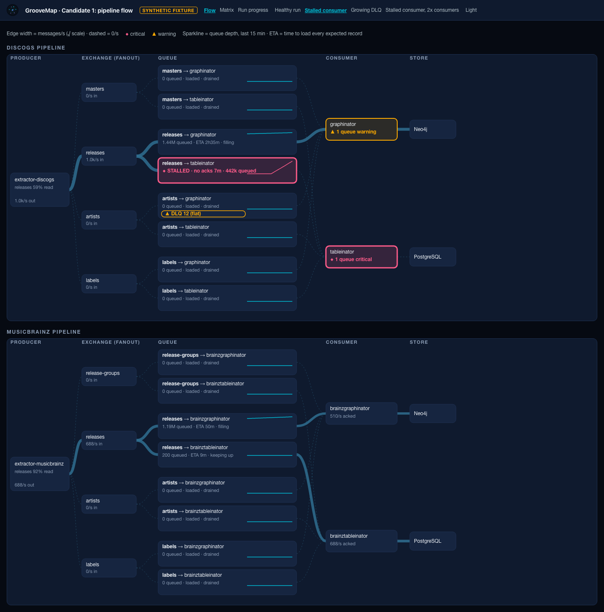
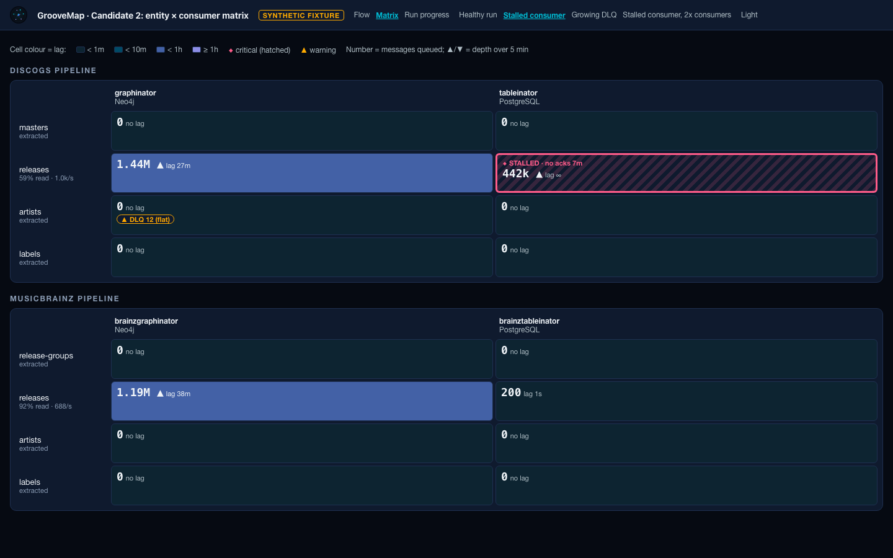
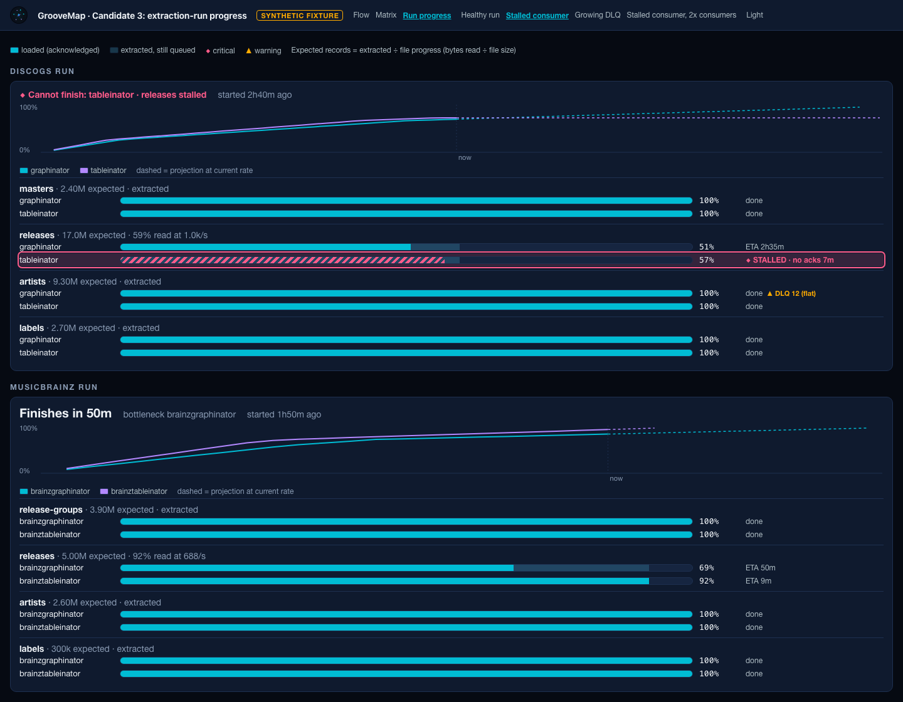

Desktop, growing DLQ, dark:

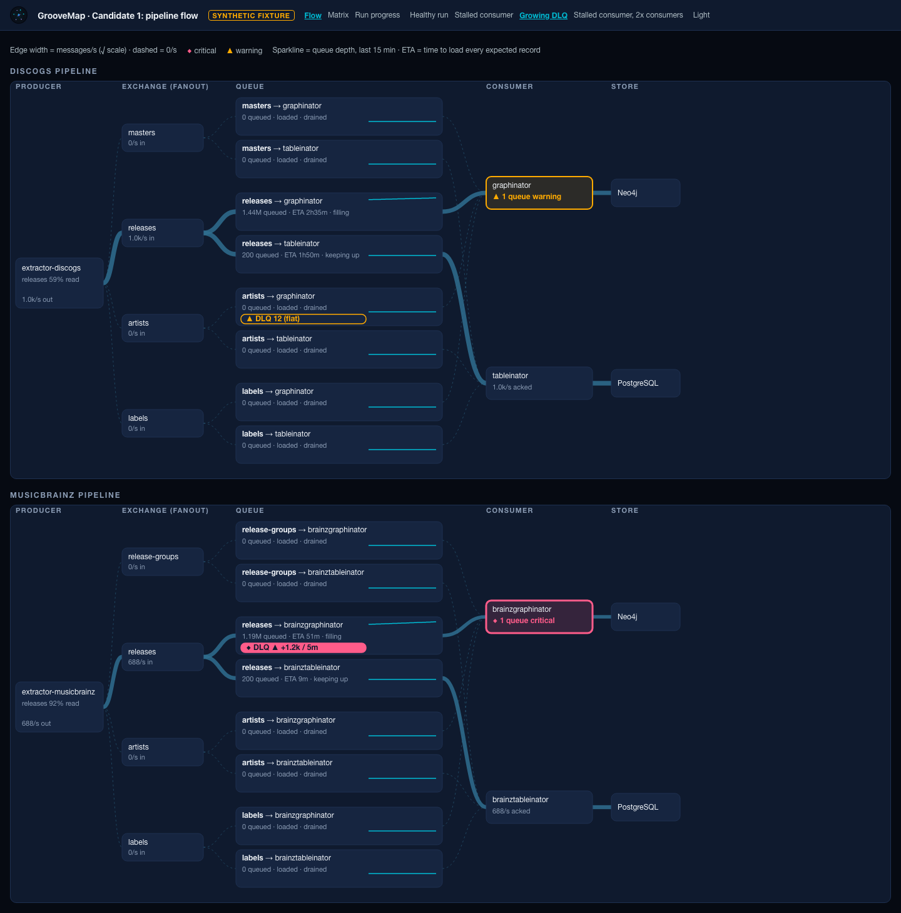
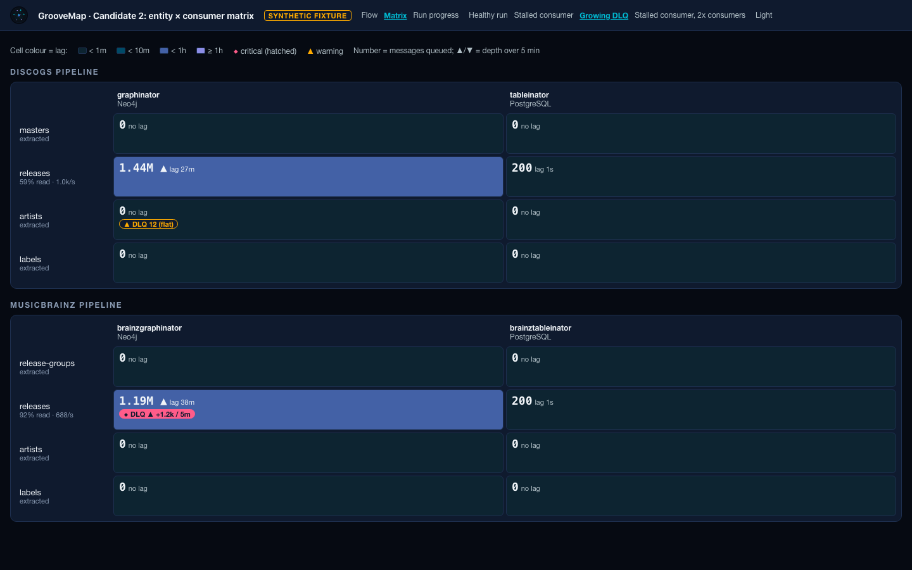
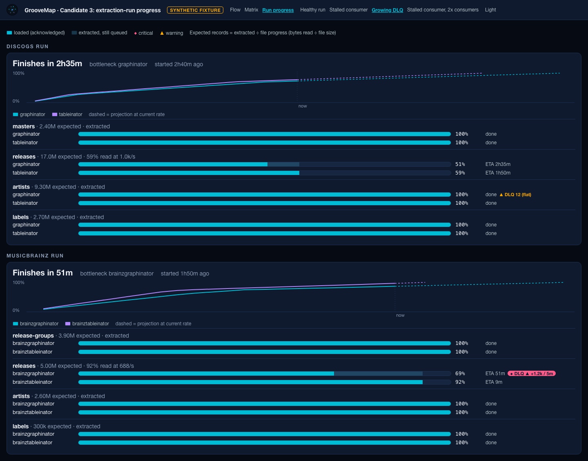

Phone (390 px), first screen:

| Flow | Matrix | Run progress |
|---|---|---|
| 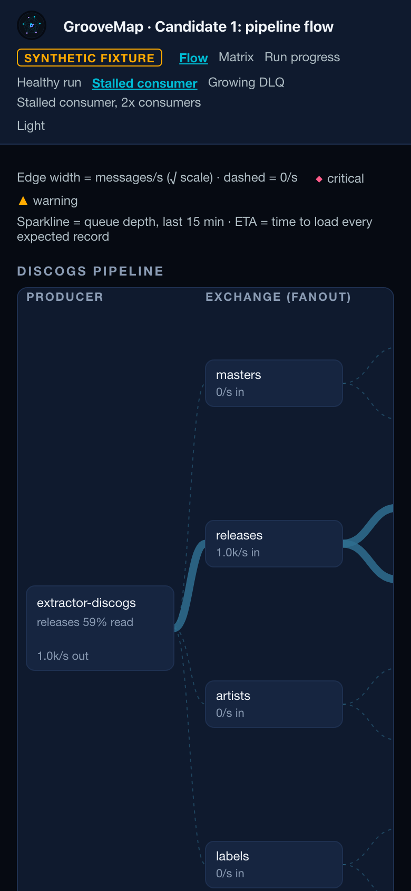 | 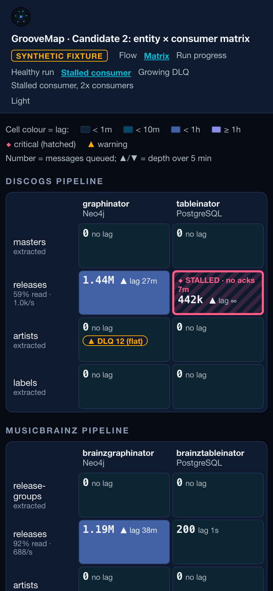 | 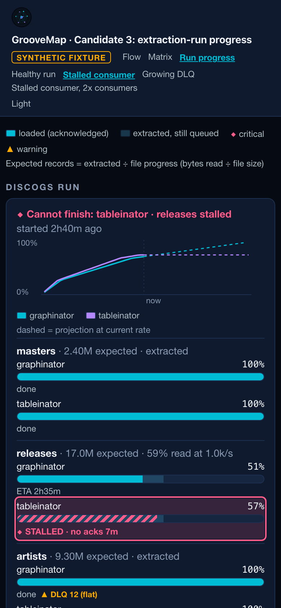 |
| 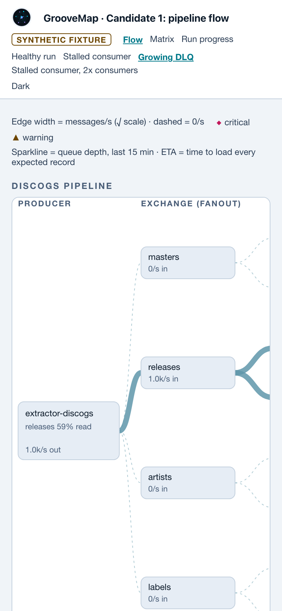 | 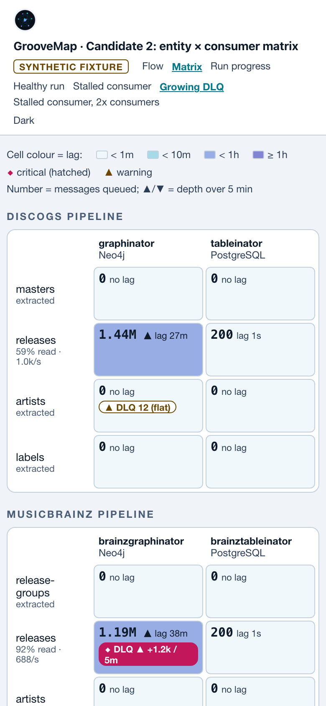 | 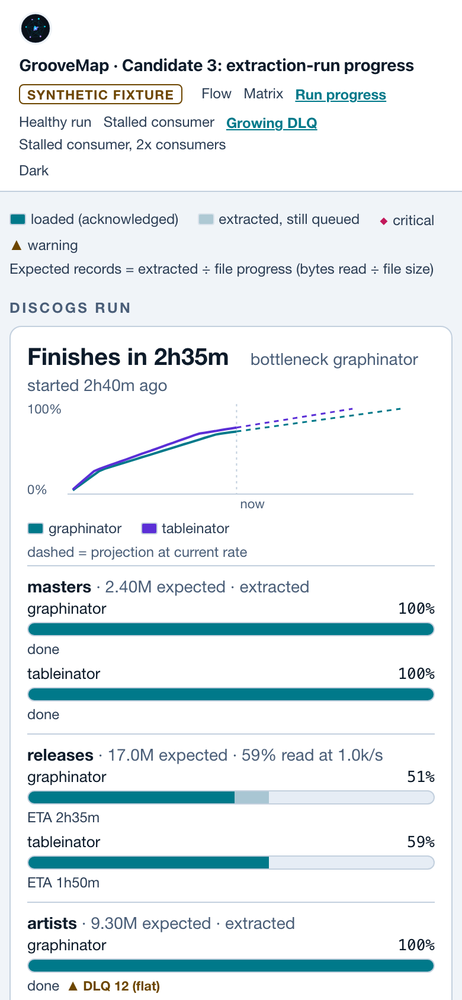 |

The full set of 28 captures in [`screenshots/`](gm-operations-console-2rf/screenshots/) also covers
light desktop, 2× consumers, deuteranopia and achromatopsia.

### What each view answers

| Operator question | Flow | Matrix | Run progress |
|---|---|---|---|
| Where is it stuck (which entity × consumer)? | yes, named in the node | yes, by row × column | yes, per row |
| Is it a consumer or the producer? | **yes**: producer rate and fan-out are visible | partly: row header shows extract % and rate | partly: "% read" vs loaded |
| Which datastore is affected? | **yes** | column header | no |
| Is a DLQ growing or just non-empty? | yes | yes | yes |
| How far behind is each queue? | ETA + sparkline | **lag colour + backlog** | gap between bars |
| When will the run finish, and what limits it? | per-queue ETA only | no | **yes: headline ETA + bottleneck, "cannot finish"** |
| Density: both pipelines in one desktop screen? | no | **yes** | no |

### Findings that apply whatever view is chosen

- **"Rate unknown" is reported as 0.0.** `QueueInfo` reports 0.0 when no rate can be computed
  (the first scrape, or a counter reset; see `RateTracker`). Any "no acks for N seconds" stall rule
  would then fire falsely after a console restart or a broker counter reset. The live model should
  carry a nullable rate (or a `rate_known` flag) before the stalled rule ships. This is a data fix,
  not a view choice.
- **% loaded and ETA need data the live snapshot does not have.** Extractor `/health` reports
  record counts but no denominator. The denominator exists only as the OTel gauge
  `groovemap.extraction.file.progress` in VictoriaMetrics. The view also needs a per-run baseline of
  each queue's acked counter, which resets when the broker restarts. Run progress therefore depends
  on either the extractor exposing `file_progress` on `/health` or a VictoriaMetrics query, plus a
  stored run-start baseline.
- **The health rules matter more than the chart form.** All three views found both faults with zero
  false alarms because they share explicit rules and keep healthy states quiet. Today's page has
  neither. The rules belong next to the topology (`/api/topology` or the attention bar, krq), so
  every view and the attention bar agree. An attention bar that names the fault makes "find it" one
  fixation in any view. The primary view should therefore be chosen for context, density, phone and
  scaling, which is how the verdicts below weigh it.

## Verdict

| Candidate | Verdict | Why |
|---|---|---|
| (2) Entity × consumer matrix | **GO, primary Overview** | The only view with both pipelines and every fault on the first screen at 1440 and 390 px. Height does not change with 2× consumers on desktop. No false alarms. Colour encodes one continuous quantity (lag) with a CVD-safe, lightness-stepped ramp. Costs: header lookup (2 fixations), no ETA, and little upstream context. Needs the stacked phone fallback above two consumers, because the plain grid breaks 13 words at 2×. |
| (3) Per-run progress with ETA | **GO, secondary view**, and its headline ETA / "cannot finish" line in the Overview | The only view that answers "when will it finish, and what is the bottleneck", and it turns a stall into "Cannot finish: tableinator · releases stalled". Reflows cleanly on phones but is long (1.9–2.8k px), and a fault in the second pipeline is off the first screen. Depends on the expected-total and run-baseline data above. |
| (1) Left-to-right flow | **NO-GO** as an Overview view | Names the fault inside its node (1 fixation when visible) and is the only view that shows producer → exchange → store causality. But at 390 px it needs horizontal panning, with the fault 2+ screens away. It is 1.6× taller than the matrix at 1×, 2.9× at 2× consumers. With most entities finished, most edges are dashed 0/s hairlines that add clutter without information. At 2× the fan-in into consumers becomes unreadable. Its one unique answer, upstream vs downstream cause, is partly covered by the matrix row header (extract % and rate). |

## Recommendation

- **Primary Overview view: the entity × consumer matrix** (bead `cn6`). One matrix per pipeline,
  rendered from `/api/topology`. Cells show backlog, a 5-minute trend, lag colour and a DLQ badge.
  Row headers show extraction progress, and the shared health rules mark state with ◆/▲ and labels.
  Include the stacked layout below 480 px when a pipeline has more than two consumers, and the
  lightness-stepped lag ramp from `shared.css`.
- **Above each matrix, the run-progress headline**: "Finishes in X, bottleneck Y" or
  "◆ Cannot finish: …". **Ship the full run-progress view as a secondary view** (bead `06s`) once the
  expected-total and run-baseline data exist. Until then the headline can show "ETA unavailable"
  rather than a guessed number.
- **Do not ship the flow as an Overview view** (bead `9nd`). The decision bead (`8eg`) should
  `/bh:replan gm-operations-console-t34`. Either close `9nd` with this record as the reason, or
  re-scope it to an optional, desktop-only, single-pipeline drill-down opened from a matrix row, with
  the lowest priority. This evidence does not by itself justify building that drill-down.
- **Before any view ships:** make "rate unknown" distinct from 0.0 in the live model, and put the
  health rules where the topology and attention bar can share them.
- **Amend ADR 0018 § Pipeline visualization** (through the design-hive bead the decision bead
  files) to "entity × consumer matrix primary; run progress secondary; flow not adopted". Cite this
  document, and state that the evidence came from synthetic fixtures and a fixation model rather than
  operator trials. A short check with a real operator on a real run, once one is available, is still
  worth doing before the Overview is considered final.

### Reproduce

```sh
uv run python docs/spikes/gm-operations-console-2rf/simulate.py   # writes fixtures.js (synthetic)
uv run python docs/spikes/gm-operations-console-2rf/evaluate.py   # writes evaluation.json, screenshots/, prints tables
open docs/spikes/gm-operations-console-2rf/matrix.html            # ?fixture=growing-dlq&theme=light
```
